# AI-Powered IPsec VPN Protocol Analyzer & Security Assessment Framework

> **Problem Statement ID**: 26160  
> **Problem Statement Title**: AI-Powered IPsec VPN Protocol Analyzer and Security Assessment Framework  
> **Organization**: National Technical Research Organisation (NTRO)  
> **Category**: Software | **Theme**: Blockchain & Cybersecurity  

---

## 1. Executive Summary

Virtual Private Networks (VPNs) built upon the **IPsec protocol suite** are foundational to securing communications across government, military, enterprise, and intelligence infrastructures. However, vulnerabilities routinely arise from misconfigurations, weak cryptographic suites, deprecated hash algorithms, inadequate Diffie-Hellman groups, and disabled Perfect Forward Secrecy (PFS).

This repository contains a **production-grade, end-to-end AI-driven IPsec protocol analysis and security assessment framework**. The platform autonomously inspects live packet streams or captured network traces (`.pcap`), infers operating modes (Tunnel vs. Transport), dissects IKEv1/IKEv2 Security Associations, fingerprints internal encrypted traffic (VoIP, WhatsApp, Web, Email, Video, ICMP) without decryption using statistical machine learning, evaluates compliance against **NIST SP 800-77 Rev. 1**, **RFC 8221**, and the **NSA CNSA Suite**, and automatically generates executive risk scores, MITRE-aligned threat matrices, and actionable hardening recommendations.

---

## 2. Key Capabilities & Deliverables Matrix

| Requirement / Module | Implementation in Framework | Status |
| :--- | :--- | :---: |
| **a) VPN Testbed Generation** | Standalone Scapy-based multi-scenario traffic synthesizer + StrongSwan container lab configurations covering Tunnel/Transport, AES-GCM/CBC, 3DES, DH 1–20, PFS, IPv4/IPv6, and diverse application traffic. | ✅ Complete |
| **b) Traffic Capture & Dissection** | High-performance binary dissector extracting IKEv1/v2 SAs, Proposals, Transforms, DH Key Exchanges, Nonces, ESP SPIs, Sequence numbers, and anti-replay counters. | ✅ Complete |
| **c) AI-Based Classification** | 22-dimensional statistical flow feature extractor coupled with trained Ensemble Classifiers (Random Forest & Gradient Boosting) predicting encrypted ESP payloads (VoIP, WhatsApp, Web, Email, Video, ICMP) with confidence scores. | ✅ Complete |
| **d) Security Assessment Engine** | Cryptographic strength auditor evaluating Sweet32 (3DES), Logjam (DH < 2048), broken hashes (MD5, SHA-1), PFS enforcement, and sequence counter wraparound vulnerabilities. | ✅ Complete |
| **e) Automated Reports & Scoring** | Quantitative Composite Risk Score (0–100), Risk Tier classification, MITRE-aligned Threat Matrix, and exportable Executive & Deep Technical HTML/JSON/SARIF reports. | ✅ Complete |
| **f) Interactive Dashboard** | Modern, responsive dark-theme SOC analyst web console built with Tailwind CSS, Chart.js, and Lucide icons with packet hex inspection and one-click testbed execution. | ✅ Complete |

---

## 3. System Architecture

```mermaid
flowchart TD
    subgraph Testbed [1. VPN Testbed & Traffic Synthesizer]
        TG1[Matrix Generator: Modes, Ciphers, DH Groups, PFS]
        TG2[Application Flow Synthesizer: VoIP, WhatsApp, Web, Email, Video, ICMP]
        TG3[PCAP Export Engine: IKEv1/v2 Handshake + ESP Sequences]
    end

    subgraph Parser [2. Deep Protocol Inspection & Parsing Engine]
        P1[PCAP Stream / File Ingestor]
        P2[IKEv1 / IKEv2 Dissector: SA, Transforms, KE, Nonce, ID, NAT-T]
        P3[ESP & AH Dissector: SPI, Sequence, IV, Entropy, Transport/Tunnel Signatures]
        P4[Flow Reconstructor & Statistical Feature Extractor]
    end

    subgraph AIEngine [3. AI Classification & Inference Engine]
        M1[Operational Mode Classifier: Tunnel vs Transport]
        M2[Cryptographic Parameter & SA Attribute Matcher]
        M3[Encrypted ESP Payload Classifier: Ensemble Random Forest / Gradient Boosting]
        M4[Confidence Scoring & Feature Importance Explainer]
    end

    subgraph SecurityAssessment [4. Security Assessment & Compliance Engine]
        S1[NIST SP 800-77 Rev.1 / RFC 8221 Compliance Auditor]
        S2[Weak Cipher / DH Group / Broken Hash Detector]
        S3[Replay Protection & Sequence Wraparound Auditor]
        S4[PFS & Metadata Exposure Scanner]
        S5[Composite Risk Score 0-100 & Threat Matrix Generator]
    end

    subgraph UIReport [5. Web Dashboard & Automated Reporting]
        API[FastAPI Backend: REST Endpoints & Analysis Pipelines]
        DASH[Modern Analyst Dashboard: Graphs, Packet Dissector, Threat Matrix]
        REP[Executive & Technical Report Generator: HTML / JSON / SARIF]
    end

    Testbed --> Parser
    Parser --> AIEngine
    Parser --> SecurityAssessment
    AIEngine --> SecurityAssessment
    SecurityAssessment --> UIReport
```



---

## 4. Directory & Module Structure

```
MASH2/
├── .venv/                         # Isolated virtual environment
├── requirements.txt               # Locked dependencies
├── run.sh                         # One-click system launcher (API + Dashboard)
├── setup_env.sh                   # One-click environment bootstrap script
├── README.md                      # Complete system documentation
├── config/
│   ├── security_rules.json        # NIST / CNSA / RFC cryptographic rules & CVE mappings
├── core/                          # Deep packet inspection and security assessment
│   ├── __init__.py
│   ├── pcap_reader.py             # PCAP/PCAPNG parser & packet streaming
│   ├── ike_parser.py              # RFC 2409 / RFC 7296 IKEv1 & IKEv2 dissector
│   ├── esp_parser.py              # RFC 4303 ESP / RFC 4302 AH dissector & mode inference
│   ├── flow_extractor.py          # 22-dimensional statistical flow feature extractor
│   └── security_engine.py         # Compliance rules, risk scoring, threat matrix generator
├── ml/                            # Machine learning & AI classification
│   ├── __init__.py
│   ├── feature_pipeline.py        # Feature engineering, scaling, and sanitization
│   ├── train_model.py             # Model training lifecycle script adhering to ML best practices
│   ├── classifier.py              # Runtime inference engine with confidence metrics
│   └── saved_models/              # Serialized trained model & scaler (.joblib)
├── testbed/                       # Testbed & traffic generation
│   ├── __init__.py
│   ├── traffic_generator.py       # Scapy-based synthetic IPsec PCAP generator for all permutations
│   ├── strongswan/                # Real-world Linux strongSwan configurations
│   │   ├── ipsec.conf
│   │   └── docker-compose.yml
│   └── samples/                   # Pre-generated benchmark scenario PCAPs
├── reports/                       # Automated reporting engine
│   ├── __init__.py
│   ├── generator.py               # Generates Executive & Technical HTML/JSON reports
│   └── generated/                 # Generated audit reports
├── web/                           # Modern interactive dashboard
│   ├── __init__.py
│   ├── app.py                     # FastAPI REST API backend
│   └── templates/
│       └── index.html             # Single-page interactive analyst console
└── tests/                         # Automated unit & integration tests
    ├── test_parser.py             # Packet parser & flow extraction tests
    ├── test_security_engine.py    # Compliance & risk score validation
    ├── test_classifier.py         # AI inference & feature pipeline verification
    └── test_api.py                # FastAPI REST endpoint integration tests
```

---

## 5. Machine Learning & Encrypted Traffic Classification

Traditional Deep Packet Inspection (DPI) fails when traffic is encapsulated in encrypted ESP packets (IP protocol 50). This framework implements **Statistical Encrypted Traffic Fingerprinting** using 22 flow-level statistical metrics:

### Feature Extraction Pipeline (`core/flow_extractor.py`):
1. **Packet Size Statistics**: Mean, Standard Deviation, Minimum, Maximum, Median, 25th/75th/90th Percentiles, Skewness.
2. **Inter-Arrival Times (IAT)**: Mean IAT, IAT Standard Deviation, Minimum IAT, Maximum IAT, Jitter (mean consecutive $\Delta\text{IAT}$).
3. **Throughput Dynamics**: Packet Rate ($\text{pkts}/\text{sec}$), Byte Rate ($\text{bytes}/\text{sec}$), Total Duration.
4. **Packet Size Binning**: Small Packet Ratio ($<200\text{B}$), Medium Packet Ratio ($200\text{B}-900\text{B}$), Large Packet Ratio ($>900\text{B}$).
5. **Directional & Burst Dynamics**: Forward/Backward Packet Ratio, Forward/Backward Byte Ratio, Average Burst Size.

### Supported Application Profiles:
- **VoIP (Voice over IP)**: Symmetrical duplex RTP streams, small packets ($\sim 140\text{B}$), ultra-tight IAT ($\sim 20\text{ms}$), low jitter.
- **WhatsApp / Chat**: Bursty sporadic packets ($\sim 180-260\text{B}$), push notifications, long idle keepalive gaps ($0.3-1.0\text{s}$).
- **Web Browsing**: Asymmetric transaction flows (client requests $\ll$ server responses), heavy bimodal distribution ($64\text{B}$ ACKs + $1460\text{B}$ TLS chunks).
- **Email**: Intermittent body transfer bursts across SMTP/IMAP protocol transactions.
- **Video Streaming**: Continuous sustained downstream traffic, heavily biased toward maximum transmission units ($1350-1500\text{B}$) at high packet rates.
- **ICMP**: Diagnostic ping bursts with fixed payload length and strict $1.0\text{s}$ interval cadence.

---

## 6. Security Assessment & Threat Engine

Configurations are audited against:
- **NIST Special Publication 800-77 Rev. 1**: *Guide to IPsec VPNs*
- **RFC 8221**: *Cryptographic Algorithm Implementation Requirements for ESP and AH*
- **RFC 8247**: *Cryptographic Algorithm Implementation Requirements for IKEv2*
- **NSA Commercial National Security Algorithm (CNSA) Suite**

### Evaluated Threat Vectors:
- **Sweet32 Attack (CVE-2016-2183)**: Detects deprecated 64-bit block ciphers (3DES, Blowfish, DES).
- **Logjam Attack (CVE-2015-4000)**: Detects weak Diffie-Hellman groups ($< 2048$-bit MODP, e.g., Group 1 and Group 2).
- **Collision-Prone Hashes**: Flags integrity verification using HMAC-MD5 or HMAC-SHA1.
- **IKEv1 Aggressive Mode PSK Leakage (CVE-1999-0524)**: Flags cleartext transmission of Pre-Shared Key hashes vulnerable to offline brute-force cracking.
- **Missing Perfect Forward Secrecy (PFS)**: Flags Child SAs established without independent DH renegotiation.
- **Replay Protection Health**: Analyzes ESP sequence number sequences for duplicates, packet reordering, and missing Extended Sequence Numbers (ESN) on high-throughput flows.

### Quantitative Composite Security Score Formula:
$$\text{Score} = 0.30 \cdot S_{\text{crypto}} + 0.20 \cdot S_{\text{dh}} + 0.20 \cdot S_{\text{pfs}} + 0.15 \cdot S_{\text{replay}} + 0.15 \cdot S_{\text{protocol}}$$

| Score Range | Risk Level | Meaning |
| :---: | :---: | :--- |
| **85 – 100** | `SECURE` | Full compliance with NIST SP 800-77 Rev. 1 & RFC 8221 |
| **70 – 84** | `LOW RISK` | Minor legacy elements present, no immediate exploitability |
| **50 – 69** | `MEDIUM RISK` | Deprecated algorithms or missing PFS require planned upgrade |
| **30 – 49** | `HIGH RISK` | Known vulnerabilities present (Sweet32, Logjam, weak hashes) |
| **0 – 29** | `CRITICAL RISK` | Severely compromised (broken MD5, IKEv1 Aggressive PSK, NULL cipher) |

---

## 7. Pre-Generated Benchmark Scenarios

The framework includes 5 pre-generated standard benchmark PCAP traces in `testbed/samples/`:
1. `scenario_1_enterprise_secure.pcap`: IKEv2, AES-256-GCM, DH Group 19 (256-bit ECP), PFS Enabled, Tunnel Mode $\rightarrow$ **Score: 100 (SECURE)**.
2. `scenario_2_legacy_vulnerable.pcap`: IKEv1 Aggressive Mode, 3DES-CBC, HMAC-MD5, DH Group 1 (768-bit MODP), No PFS $\rightarrow$ **Score: 39 (HIGH RISK)**.
3. `scenario_3_transport_voip.pcap`: IKEv2, AES-128-CBC, HMAC-SHA256, DH Group 14, Transport Mode, VoIP traffic $\rightarrow$ **Score: 100 (SECURE)**.
4. `scenario_4_whatsapp_tunnel.pcap`: IKEv2, AES-128-GCM, DH Group 14, Tunnel Mode, WhatsApp traffic $\rightarrow$ **Score: 100 (SECURE)**.
5. `scenario_5_broken_dh_video.pcap`: IKEv2, AES-256-CBC, HMAC-SHA1, DH Group 1 (Broken MODP), No PFS, Video streaming $\rightarrow$ **Score: 65 (MEDIUM RISK)**.

---

## 8. Installation & Quick Start

### Prerequisites
- Python 3.9+ (macOS, Linux, or Windows WSL)
- Bash shell

### One-Click Bootstrap
```bash
# Clone or navigate to the repository
cd MASH2

# Initialize virtual environment, install dependencies, train AI model & generate testbed PCAPs
./setup_env.sh
```

### Launch Interactive Web Dashboard
```bash
./run.sh
```
Open your browser at **`http://localhost:8000`** to access the SOC Analyst Console.

---

## 9. Verification & Automated Tests

The framework comes with a full pytest automated test suite verifying packet dissectors, ML inference, compliance scoring, and REST endpoints:

```bash
.venv/bin/pytest -v tests/
```

Expected Output:
```
tests/test_api.py::test_index_dashboard PASSED                           [  7%]
tests/test_api.py::test_list_scenarios PASSED                            [ 15%]
tests/test_api.py::test_run_scenario_endpoint PASSED                     [ 23%]
tests/test_api.py::test_generate_custom_testbed_endpoint PASSED          [ 30%]
tests/test_api.py::test_download_reports PASSED                          [ 38%]
tests/test_classifier.py::test_feature_pipeline_conversion PASSED        [ 46%]
tests/test_classifier.py::test_classifier_voip_inference PASSED          [ 53%]
tests/test_classifier.py::test_classifier_video_inference PASSED         [ 61%]
tests/test_parser.py::test_pcap_processor_and_ike_parser PASSED          [ 69%]
tests/test_parser.py::test_esp_parser_mode_and_entropy PASSED            [ 76%]
tests/test_parser.py::test_flow_extractor_features PASSED                [ 84%]
tests/test_security_engine.py::test_secure_enterprise_evaluation PASSED  [ 92%]
tests/test_security_engine.py::test_legacy_vulnerable_evaluation PASSED  [100%]

============================== 13 passed in 1.60s ==============================
```

---

## 10. REST API Specification

| Endpoint | Method | Description |
| :--- | :---: | :--- |
| `/` | `GET` | Interactive Analyst Web Dashboard (HTML5/Tailwind/Chart.js) |
| `/api/scenarios` | `GET` | List available pre-generated testbed scenarios |
| `/api/scenarios/run` | `POST` | Execute analysis on a selected scenario PCAP |
| `/api/analyze` | `POST` | Upload and analyze an arbitrary `.pcap` or `.pcapng` file |
| `/api/testbed/generate` | `POST` | Synthesize a custom IPsec PCAP on the fly and analyze it |
| `/api/report/executive` | `GET` | Download executive security assessment report (HTML) |
| `/api/report/technical` | `GET` | Download deep technical audit report (HTML) |
| `/api/report/json` | `GET` | Download complete audit data (JSON/SARIF) |

---

## 11. StrongSwan Live Container Lab

For users testing against live Linux network namespaces, sample strongSwan configurations are available in `testbed/strongswan/`:
- `testbed/strongswan/ipsec.conf`: Multi-connection configurations (Secure IKEv2, Vulnerable IKEv1, Transport VoIP).
- `testbed/strongswan/docker-compose.yml`: Initiator and Responder dual-gateway container topology.
